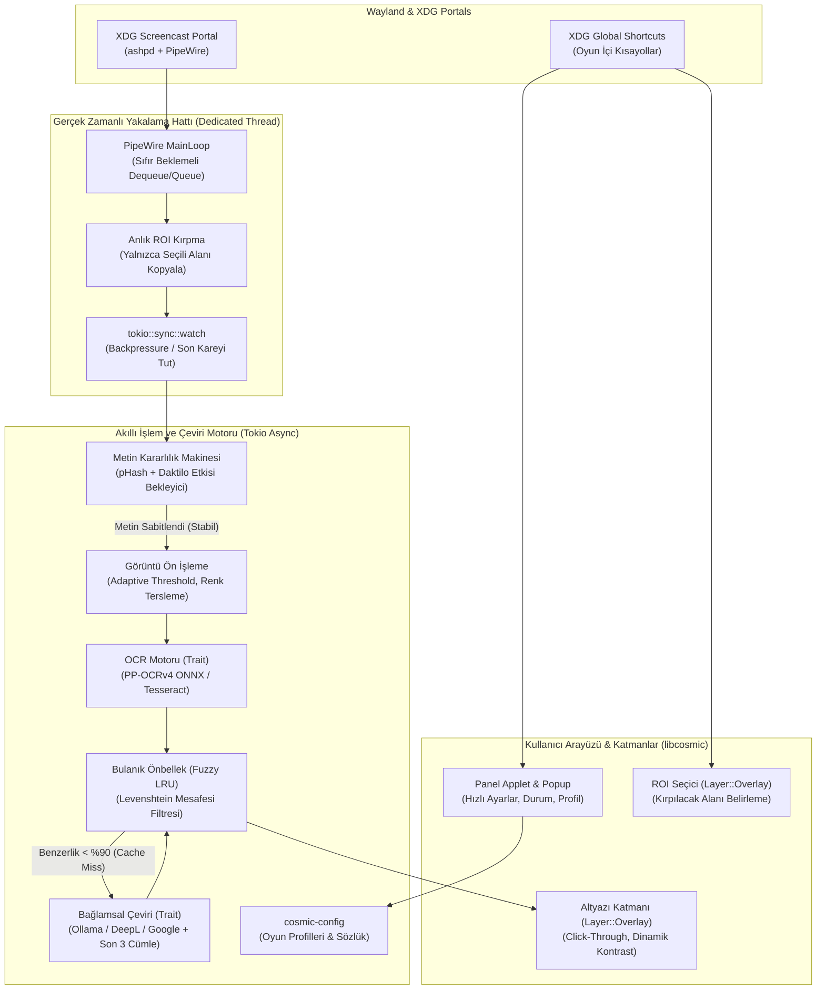

## 📄 Geliştirilmiş Mimari Plan (V2 - Taslak Metin)

Aşağıdaki güncellenmiş metni doğrudan projenin `ARCHITECTURE.md` veya `README.md` dosyası olarak kullanabilirsin:

```markdown
# COSMIC Native Screen & Game Translator (`cosmic-ext-applet-translator`)

Bu doküman, Pop!_OS ve **COSMIC Masaüstü Ortamı (Wayland)** için özel olarak tasarlanmış, Rust tabanlı, sıfır çökme garantili ve düşük gecikmeli gerçek zamanlı ekran/oyun çeviri aracının (`cosmic-ext-applet-translator`) sistem mimarisini ve geliştirme yol haritasını tanımlar.

---

## 1. Motivasyon ve Çözülen Mühendislik Problemleri

### Mevcut Araçlardaki Temel Darboğazlar
1. **Wayland Protokol Çökmesi (`ext_image_copy_capture_session_v1`):** Mevcut C++/Qt tabanlı araçlar, PipeWire üzerinden asenkron kare talep ederken önceki karenin yaşam döngüsünü tamamlamadan yeni istek göndermekte; bu da `cosmic-comp` üzerinde `Protocol error 1` hatasıyla yakalama oturumunu düşürmektedir.
2. **Daktilo Etkisi (Typewriter Effect) ve Kaynak İsrafı:** Oyunlarda harf harf akan diyaloglar sırasında sürekli 60 FPS görüntü işlenmesi, hem CPU/GPU darboğazına hem de çeviri API'lerinde hız sınırına (Rate Limit) takılmaya neden olmaktadır.
3. **Tam Ekran Oyun ve Odak Kaybı (Focus Stealing):** XWayland tabanlı eski overlay araçları tam ekran (Fullscreen) oyunlarda odak çalmakta, fare tıklamalarını engellemekte veya pencere yöneticisi tarafından arkaya atılmaktadır.

### Mimari Hedef
COSMIC ekosisteminde (`libcosmic`) yerel çalışan, **RAII tabanlı deterministik arabellek yönetimine** sahip, diyalog akışını akıllıca bekleyen (Debouncing), `zwlr_layer_shell_v1` üzerinden tıklama geçirgen (Click-Through) alt yazı çizebilen ve kısayollarla oyun içinden kontrol edilebilen modern bir Rust uygulaması geliştirmek.

---

## 2. Sistem Mimarisi ve Veri Akışı



---

## 3. Alt Sistem Detayları ve Teknik Tasarım

### 3.1. Güvenli PipeWire Döngüsü ve Backpressure Yönetimi

* **Teknoloji:** `ashpd` (Screencast + PersistMode) + `pipewire` + `tokio::sync::watch`.
* **Çökme Önleyici Mimarisi:**
1. **Ayrık İş Parçacığı (Dedicated PW Thread):** PipeWire döngüsü, Tokio async runtime'dan bağımsız, özel bir OS thread'inde çalışır.
2. **Anında Kırpma ve İade (Instant Crop & Return):** `stream.dequeue_buffer()` ile alınan kare üzerinde tam ekran kopyalama **yapılmaz**. Sadece kullanıcının seçtiği alt yazı kutusu (ROI) koordinatları belleğe kopyalanır ve arabellek mikrosaniyeler içinde `queue_buffer()` ile `cosmic-comp`'a iade edilir.
3. **Kare Düşürme (Frame Dropping):** Kopyalanan ROI görüntüsü `tokio::sync::watch` kanalına yazılır. Eğer OCR motoru önceki kareyle meşgulse aradaki kareler birikmez (bellek şişmez), motor her zaman en son kareyi okur.


### 3.2. Daktilo Etkisi Önleyici (Frame Debouncer & Stability State Machine)

Oyunlarda harf harf beliren diyalogların yarım çevrilmesini önlemek için 3 durumlu bir sonlu durum makinesi (FSM) çalışır:

1. **`Idle` (Boşta):** Kareler arası pHash farkı eşik değerin (örn. `< 2 bit`) altındadır. CPU kullanımı %0'a yakındır.
2. **`Animating` (Metin Yazılıyor):** pHash değişimi algılandı! Ancak hemen OCR çalıştırılmaz; sistem metnin ekrana yazılmaya devam ettiğini varsayar ve 150-250ms'lik aralıklarla kare farkını izler.
3. **`Settled` (Kararlı - OCR Tetikle):** Görüntü değişimi durduğunda (iki ardışık kontrol arasında fark kalmadığında) cümlenin tamamlandığı anlaşılır ve görüntü işleme hattı tetiklenir.

### 3.3. Oyun Odaklı Görüntü Ön İşleme (Pre-Processing)

Oyun fontları yarı-saydam kutular üzerinde renkli veya gölgeli olabilir. Ham görüntüyü doğrudan OCR'a vermek yerine `imageproc` ile şu adımlar uygulanır:

* **Lanczos3 Ölçekleme:** Küçük fontlar OCR başarısını artırmak için 1.5x–2x büyütülür.
* **Morfik Kontrast & Binarizasyon:** Açık renkli metinleri koyu arka plandan ayırmak için Otsu eşikleme (Thresholding) ve renk tersleme (Invert - siyah zemin üzerine beyaz yazıyı, beyaz zemin üzerine siyah yazıya çevirme) uygulanır.

### 3.4. OCR Katmanı (Modern Rust Trait)

Rust 1.75+ yerel async trait desteği kullanılır:

```rust
pub trait OcrBackend: Send + Sync {
    fn recognize(&self, image: &image::DynamicImage) -> impl std::future::Future<Output anyhow::Result<String>> + Send;
}

```

* **Birincil Motor (PaddleOCR / ONNX):** `ort` veya saf Rust tabanlı `ocrs` / `tract-onnx` kullanılarak PP-OCRv4 modelleri çalıştırılır. Harici sistem kütüphanesi gerektirmez, stilize oyun fontlarında ve CJK (Japonca/Çince/Korece) dillerinde Tesseract'tan çok daha üstündür.
* **İkincil Motor (Tesseract):** Düşük donanımlı sistemler için opsiyonel `leptess` desteği.

### 3.5. Bulanık Önbellek (Fuzzy Cache) ve Bağlamsal Çeviri

```rust
pub struct TranslationContext {
    pub history: std::collections::VecDeque<(String, String)>, // Son 3 (Kaynak, Çeviri) çifti
    pub glossary: std::collections::HashMap<String, String>,   // Özel oyun terimleri / karakter adları
}

pub trait TranslationBackend: Send + Sync {
    fn translate(
        &self,
        text: &str,
        src_lang: &str,
        target_lang: &str,
        ctx: &TranslationContext,
    ) -> impl std::future::Future<Output anyhow::Result<String>> + Send;
}

```

* **Levenshtein Filtresi (`strsim` crate):** OCR motoru arka plandaki bir kıpırtı yüzünden noktalama işaretini yanlış okusa bile (`"Hello!"` yerine `"Hello."`), önceki metinle benzerlik oranı `%90` üzerindeyse API çağrısı yapılmaz, mevcut çeviri ekranda tutulur.
* **Bağlamsal LLM Çevirisi (Ollama / OpenAI Uyumlu API):** Yerel çalışan Qwen2.5 / Gemma / Llama modellerine sadece mevcut cümle değil, `TranslationContext` içindeki son 3 diyalog satırı da sistem prompt'u ile verilir. Böylece zamir ve karakter cinsiyeti hataları ortadan kalkar.

### 3.6. Layer-Shell Altyazı Katmanı ve Oyun İçi Kısayollar

* **Click-Through Layer Shell (`cctk` / `libcosmic`):**
* `Layer::Overlay` ve `Anchor::Bottom` (veya kullanıcının seçtiği ROI koordinatlarına kenetlenmiş konum).
* `exclusive_zone(-1)`: Tam ekran oyunların çözünürlüğünü veya COSMIC pencere dizilimini (Tiling) bozmaz.
* `wl_surface.set_input_region(None)`: Tüm fare tıklamaları doğrudan altındaki oyuna geçer.


* **Oyun İçi Kısayollar (`ashpd::desktop::global_shortcuts`):**
* `Super + Alt + S`: Oyundan çıkmadan yeni ekran alanı (ROI) seç.
* `Super + Alt + T`: Çeviriyi duraklat / devam ettir.
* `Super + Alt + H`: Altyazı katmanını geçici olarak gizle/göster.


---

## 4. Geliştirme Yol Haritası (Milestones)

### Faz 1: Çekirdek İskelet ve Güvenli Yakalama (MVP)

* [ ] Workspace mimarisinin kurulması: `translator-core` (kütüphane), `cosmic-applet-translator` (panel UI) ve `cosmic-translator-overlay` (layer-shell).
* [ ] `ashpd` ile Screencast oturumu başlatma (`PersistMode::ExplicitlyRevoked` ile token saklama).
* [ ] PipeWire thread'i, ROI kırpma ve `tokio::sync::watch` hattının kurulması; `cosmic-comp` üzerinde sıfır `Protocol error 1` testi.

### Faz 2: Kararlılık Makinesi (Debouncer) ve OCR Hattı

* [ ] pHash tabanlı `Idle -> Animating -> Settled` durum makinesinin kodlanması.
* [ ] `imageproc` ile gri tonlama, kontrast artırma ve binarizasyon filtrelerinin eklenmesi.
* [ ] ONNX / PP-OCRv4 (veya Tesseract) entegrasyonu ve birim testleri.

### Faz 3: Layer-Shell Overlay ve ROI Seçici

* [ ] Ekranda fare ile dikdörtgen çizerek alan seçmeyi sağlayan yarı-saydam `Selector` katmanı.
* [ ] Seçilen alanın koordinatlarını `cosmic-config` içerisine oyun profili olarak kaydetme.
* [ ] Tıklama geçirgen (`empty input region`) alt yazı penceresinin oluşturulması ve konturlu (outlined) metin çizimi.

### Faz 4: Bağlamsal Çeviri, Fuzzy Cache ve Kısayollar

* [ ] `strsim` ile Levenshtein tabanlı bulanık LRU önbellek katmanı.
* [ ] Google, DeepL ve bağlam destekli yerel Ollama istemcilerinin yazılması.
* [ ] XDG Global Shortcuts portalı ile oyun içi kısayolların bağlanması.

```

---

## 💡 Sonundaki 3 Soruya Teknik Tavsiyelerim

Planın sonunda yer alan karar noktaları için COSMIC ve Linux oyun ekosistemi standartlarına göre önerilerim şunlardır:

1. **OCR Tercihi (ONNX PP-OCRv4 vs Tesseract):**
   * **Kesinlikle ONNX (PP-OCRv4) birincil olmalı.** Tesseract belge okumak için tasarlanmıştır; oyunlardaki stilize fontlarda, renkli arka planlarda ve gölgeli metinlerde başarı oranı çok düşüktür. Ayrıca PP-OCR modelleri (~10-15 MB) uygulama ilk çalıştığında `~/.local/share/cosmic-applet-translator/models/` altına otomatik indirilebilir; böylece kullanıcının `apt install tesseract-ocr-eng` gibi paketlerle uğraşmasına gerek kalmaz.
2. **Form Faktörü (Sadece Applet vs Hibrit):**
   * **Cargo Workspace ile Hibrit (Daemon/Overlay + Applet) Mimari** en sağlıklısıdır. COSMIC panel applet'leri panel yeniden başladığında kapanıp açılabilir. Ayrıca panel popup'ı küçük olduğu için "Oyun Sözlüğü düzenleme", "OCR ön işleme filtresini canlı önizleme" veya "Geçmiş diyalogları okuma (Log Window)" gibi özellikler popup'a sığmaz.
   * **Öneri:** Çekirdek mantığı `translator-core` crate'inde tut. Panelde hafif bir Applet dursun, ancak "Gelişmiş Ayarlar & Diyalog Geçmişi" tıklandığında standart bir `libcosmic` penceresi açabilsin.
3. **Proje İsmi ve İsimlendirme Standartları:**
   * COSMIC topluluğunda üçüncü parti eklentiler ve uygulamalar genellikle `cosmic-ext-` önekiyle adlandırılır (Flatpak ID'si olarak `com.github.kullaniciadi.cosmic-ext-applet-translator` gibi).
   * Eğer akılda kalıcı bir marka ismi istersen: **`cosmic-ext-lingua`**, **`cosmic-hud-translator`** veya **`aether-hud`** (oyun içi HUD katmanı vurgusu yaptığı için) oldukça şık duracaktır.

İstersen bir sonraki adımda **Faz 1'deki PipeWire + `ashpd` döngüsünün çökme yapmayan (RAII uyumlu) Rust kod iskeletini** veya `Cargo.toml` workspace yapısını doğrudan yazabilirim. Hangi modülden başlamak istersin?

```