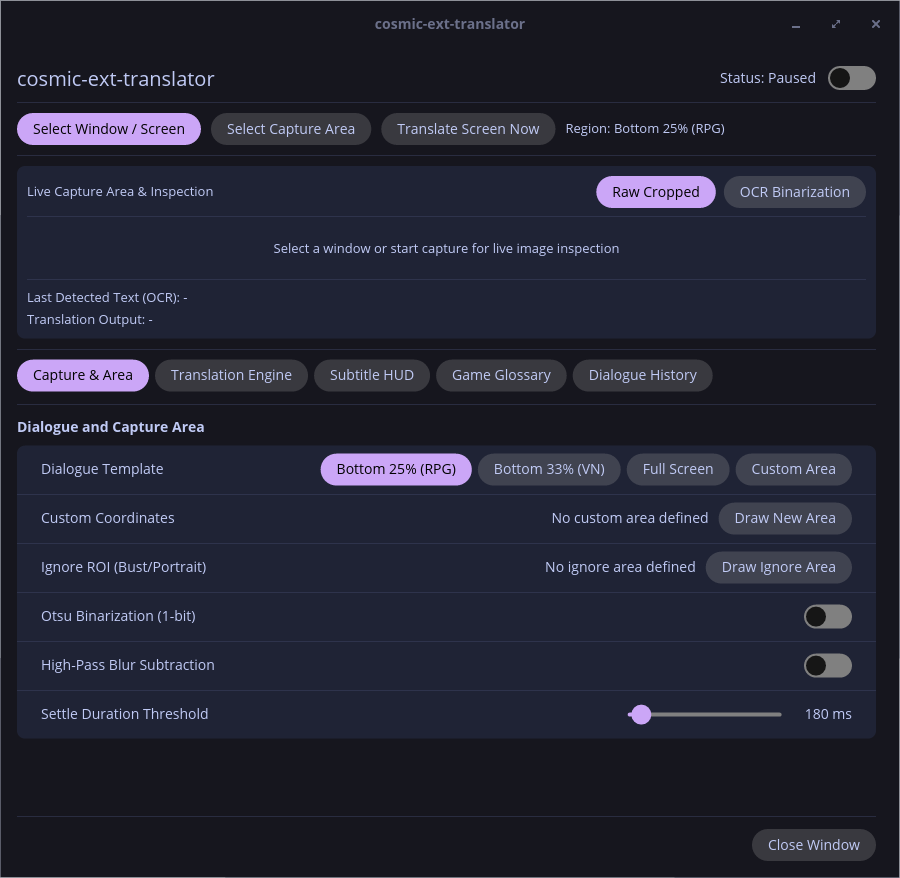
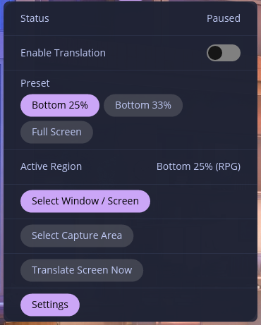
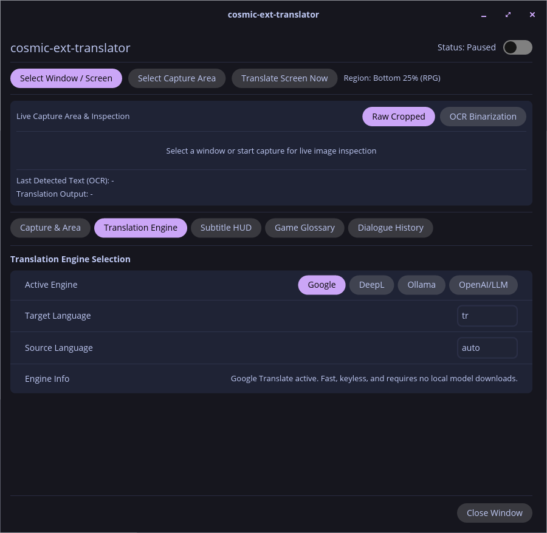
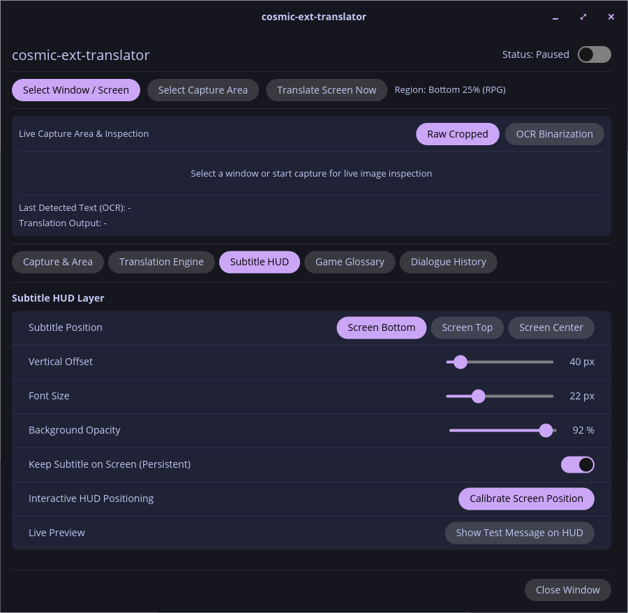
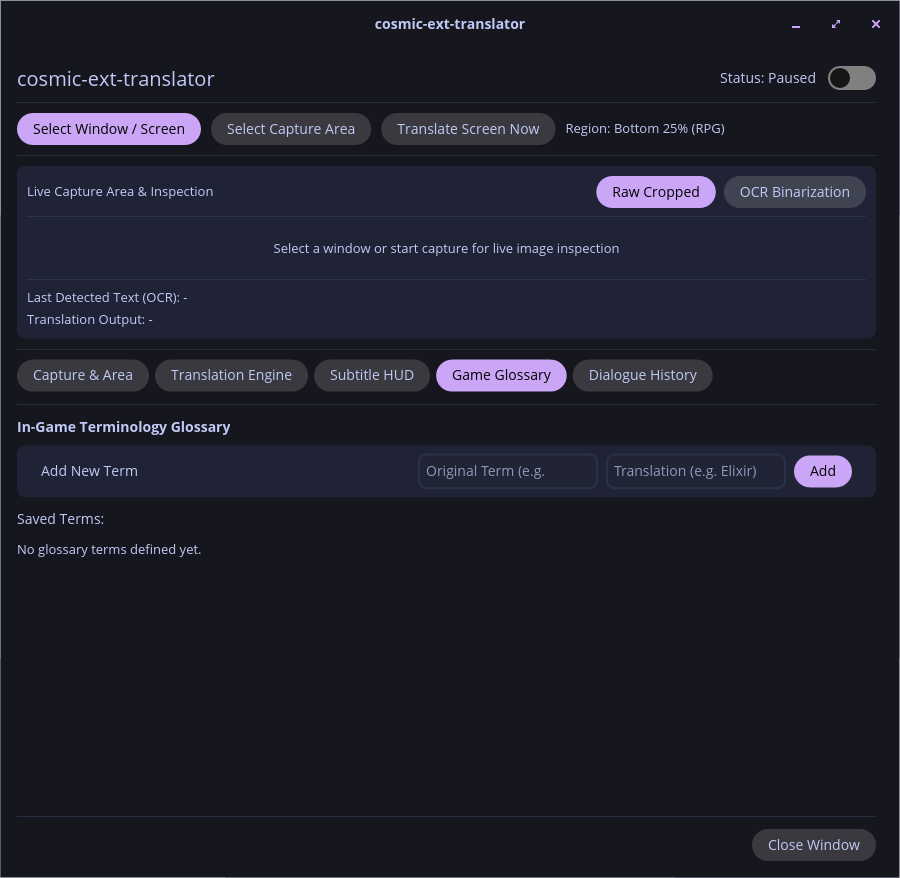
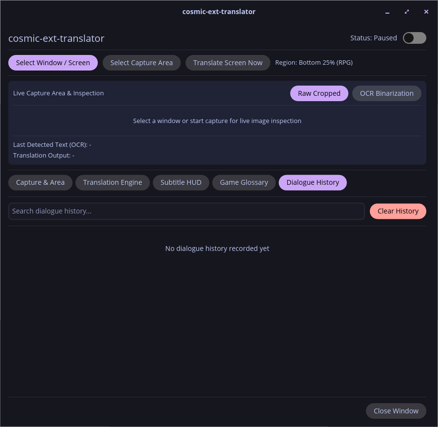

# cosmic-ext-translator

**Real-time Wayland Screen and Game Subtitle Translator for COSMIC Desktop**

`cosmic-ext-translator` is a native COSMIC desktop translation suite designed for full-screen games, visual novels, and desktop applications. It captures on-screen text in real time, runs OCR and contextual machine translation, and renders translated text into an input-transparent (click-through) Wayland layer-shell HUD overlay without focus stealing or frame pacing degradation.



---

## Technical Pipeline & Capabilities

The architecture is designed around zero focus loss, deterministic buffer lifecycles, and low CPU/GPU overhead:

1. **Non-blocking Screen Capture (`ashpd` + PipeWire):**
   - Utilizes XDG Desktop Portal Screencast with `restore_token` caching to remember screen capture permissions across launches.
   - PipeWire event loop executes on a dedicated OS worker thread (`std::thread`), decoupled from Tokio async execution.
   - Buffer negotiation acquires only the user-defined Region of Interest (ROI) and immediately drops the raw Spa buffer (`dequeue_buffer()`), preventing buffer starvation or compositor session drops.
   - **Inner Ignore Masking (`ignore_roi`):** Sub-regions within the active capture area (such as animated character portraits, live busts, or mini-maps) can be masked out prior to debouncing and OCR to eliminate false positive triggers.

2. **Two-Stage Hybrid Trigger (`TextGate` Debouncer):**
   - **64-bit dHash + Levenshtein Similarity:** Distinguishes dialogue typewriter animation (letter-by-letter streaming in RPGs/VNs) and 3D background movement.
   - Frames must remain stable for `settle_duration` (configurable, default 250ms) before triggering OCR inference, preventing rate-limit exhaustion and compute waste.
   - **High-Pass Blur Subtraction Filter:** Optional Gaussian blur subtraction filter attenuates smooth background gradients and illumination shifts while sharpening low-contrast text edges.

3. **Pure-Rust OCR, Vertical CJK Layout, and Furigana Pruning:**
   - **Local Inference (`ocrs` + `rten`):** Runs pure-Rust neural OCR models locally with SIMD acceleration (`opt-level = 3`), eliminating external C++ runtime dependencies.
   - **Vertical CJK Topological Sorter:** Classifies aspect ratios ($H/W > 1.4$), clusters vertical columns via horizontal overlap metrics, and enforces right-to-left (RTL) column ordering with top-to-bottom (TTB) reading sequences for Japanese and Chinese text. Preserves space-aware joins between Western and CJK tokens.
   - **Geometric Furigana Filter:** Identifies and filters out undersized phonetic ruby/furigana annotations adjacent to kanji characters while preserving essential punctuation marks.

4. **Context-Aware Translation and Speaker Disambiguation:**
   - **Speaker Tag Extraction:** Parses speaker names enclosed in 7 standard bracket styles (`【...】`, `〔...〕`, `「...」`, `[...]`, `Name:`, etc.), separating the speaker label from dialogue text.
   - **In-Memory Glossary:** Replaces recognized speaker names and in-game lore terminology based on user-defined glossary pairs.
   - **Sliding Turn History (`TranslationContext`):** Maintains recent dialogue history in memory to provide context for LLM translation backends (resolving omitted pronouns and gender references in Japanese).
   - **Engines Supported:** Google Translate Web API, local Ollama LLMs (`qwen2.5:3b`, etc.), DeepL API, OpenAI-compatible endpoints, and modular offline neural engine traits (`OfflineTranslationBackend`).
   - **HTTP 429 Rate-Limit Manager:** Employs exponential backoff with retry-after parsing when remote APIs throttle requests, surfacing an active countdown pill directly on the HUD.
   - **Morphological Japanese Dictionary:** Built-in longest-prefix tokenizer and lexical lookup for Japanese game dialogue.

5. **Input-Transparent Layer-Shell HUD (`wlr-layer-shell`):**
   - Displays translations and status notifications as an overlay above full-screen windows.
   - Configured with `input_zone: Some(vec![])` to guarantee 100% click-through transparency to underlying game windows.

6. **Dialogue Backlog and Standalone Settings Dashboard:**
   - Retains up to 500 translation entries in a searchable and copyable FIFO history buffer.
   - Launches settings as a standalone COSMIC desktop application (`cosmic::app::run`) with full window decorations and system headerbar, syncing changes live to the panel applet via `cosmic-config` subscription (`watch_config`).

### Interface Showcase

<details open>
<summary><b>COSMIC Panel Applet Popup</b></summary>


</details>

<details>
<summary><b>Capture & Dialogue Area</b></summary>


</details>

<details>
<summary><b>Translation Engine Selection (Google, DeepL, Ollama, OpenAI)</b></summary>


</details>

<details>
<summary><b>Subtitle HUD Customization & Positioning Calibration</b></summary>


</details>

<details>
<summary><b>In-Game Terminology Glossary</b></summary>


</details>

<details>
<summary><b>Searchable Dialogue History & Backlog</b></summary>


</details>

---

## Workspace Architecture

The project is structured as a multi-crate Rust workspace under GPL-3.0-or-later:

| Crate | Purpose |
| :--- | :--- |
| `crates/translator-core` | Headless core engine: PipeWire capture thread, ROI and ignore masking, TextGate debouncer, blur subtraction, `ocrs` OCR inference, vertical CJK reading order sorter, furigana pruner, speaker parser, translation context, HTTP 429 manager, Japanese dictionary, and IPC socket server. |
| `crates/cosmic-translator-overlay` | Dual-mode Wayland layer-shell binary: `--hud` (click-through subtitle HUD and countdown pill) and `--selector` (interactive screen region picker). |
| `crates/cosmic-applet-translator` | COSMIC panel applet (`com.system76.CosmicExtTranslator`), popup quick-actions, and 5-tab standalone settings dashboard (Capture, Engine, Display, Glossary, History). |

---

## System Requirements

The following packages are required for compilation on Ubuntu or Pop!_OS 24.04+:

```bash
sudo apt update
sudo apt install -y build-essential pkg-config clang libclang-dev \
    libpipewire-0.3-dev libspa-0.2-dev libwayland-dev libxkbcommon-dev \
    libdbus-1-dev just
```

* **Desktop Environment:** COSMIC Desktop (`cosmic-comp` and `xdg-desktop-portal-cosmic`)
* **Optional (for local LLM translation):** [Ollama](https://ollama.com/) (`ollama pull qwen2.5:3b`)

---

## Building and Installation

The project uses `just` for workflow automation.

### Build and Test

```bash
# Verify workspace compilation
just check

# Run Clippy lints
just lint

# Execute all workspace unit, integration, and adversarial tests (180 tests)
just test
```

### Installation

```bash
# Build optimized release binaries
just build-release

# Install binaries, .desktop launcher, metainfo, and icon to system directories (/usr/bin and /usr/share)
sudo $(which just) install
```

To remove the installation:

```bash
sudo $(which just) uninstall
```

---

## Development and Direct Execution

```bash
# Run the standalone configuration dashboard and inspection window
cargo run -p cosmic-applet-translator

# Run in COSMIC panel applet mode
just run-applet

# Launch interactive region selector directly
cargo run -p cosmic-translator-overlay -- --selector

# Launch HUD subtitle overlay directly
cargo run -p cosmic-translator-overlay -- --hud

# Test PipeWire capture pipeline (requires active Wayland session)
just test-capture
```

---

## Global Shortcuts

Registered via the XDG Desktop Portal Global Shortcuts API for in-game control:

| Shortcut | Action |
| :--- | :--- |
| `Super + Alt + S` | Select capture region interactively (`--selector`) |
| `Super + Alt + T` | Toggle continuous real-time translation loop |
| `Super + Alt + H` | Toggle subtitle HUD overlay visibility |
| `Super + Alt + C` | Translate current screen immediately (one-shot trigger) |

---

## License

This project is licensed under the [GNU General Public License v3.0 or later](LICENSE) (GPL-3.0-or-later).
