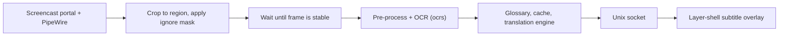

# cosmic-ext-translator

Translates on-screen text in games and visual novels on the COSMIC desktop. It reads a screen region you choose, runs OCR locally, and shows the translation as a subtitle line on top of the game. The subtitle overlay does not take mouse or keyboard input, so the game keeps focus.

<p align="center">
  
  &nbsp;&nbsp;
  
</p>

## Contents

- [Requirements](#requirements)
- [Installation](#installation)
- [Usage](#usage)
- [Translation engines](#translation-engines)
- [Settings](#settings)
- [Limitations](#limitations)
- [Troubleshooting](#troubleshooting)
- [Development](#development)
- [How it works](#how-it-works)
- [License](#license)

## Requirements

- COSMIC desktop on Wayland, with `xdg-desktop-portal-cosmic` and PipeWire running.
- Rust toolchain (stable) and [`just`](https://github.com/casey/just).
- Build dependencies. On Pop!_OS or Ubuntu 24.04 and later:

  ```sh
  sudo apt install build-essential pkg-config clang libclang-dev \
      libpipewire-0.3-dev libspa-0.2-dev libwayland-dev libxkbcommon-dev \
      libdbus-1-dev just
  ```

- Network access on first start, to download the OCR models (about 12 MB, see [OCR models](#ocr-models)).

## Installation

```sh
git clone https://github.com/hasmolam/cosmic-ext-translator
cd cosmic-ext-translator
just build-release
sudo $(which just) install
```

This installs `cosmic-applet-translator` and `cosmic-translator-overlay` to `/usr/bin`, plus the desktop entry, metainfo, and icon under `/usr/share`.

Then add the applet to the panel: **Settings → Desktop → Panel → Configure panel applets → Add applet → Screen Translator**.

To uninstall:

```sh
sudo $(which just) uninstall
```

## Usage

1. Start the game, preferably in borderless windowed or full-screen mode.
2. Open the applet in the panel and pick a region preset:
   - **Bottom 25%**: dialogue boxes in most RPGs.
   - **Bottom 33%**: larger visual novel text boxes.
   - **Full screen**
   - **Custom**: press `Super + Alt + S` and drag a rectangle over the text box.
3. Turn translation on. The first time, the portal asks which screen to share. The choice is remembered.
4. Translations appear at the bottom of the screen. New text is translated once it stops changing, so text that is typed out letter by letter is translated only after the line is complete.

### Shortcuts

Registered through the XDG Global Shortcuts portal. You can change them in COSMIC's keyboard settings.

| Shortcut | Action |
| :--- | :--- |
| `Super + Alt + S` | Select capture region |
| `Super + Alt + T` | Start/stop translation |
| `Super + Alt + H` | Show/hide subtitles |
| `Super + Alt + C` | Translate the current screen once |

## Translation engines

Select an engine in **Settings → Engine**.

| Engine | Needs | Notes |
| :--- | :--- | :--- |
| Google Translate | Nothing | Default. Uses the public web endpoint. It can be rate-limited during heavy use. |
| DeepL | API key | Free or Pro key from deepl.com. |
| Ollama | Local [Ollama](https://ollama.com/) server | Default `http://localhost:11434` with `qwen2.5:3b`. Runs fully offline. Recent dialogue lines are sent as context. |
| OpenAI-compatible | Endpoint, API key, model | Default `https://api.openai.com/v1` with `gpt-4o-mini`. Works with any server that implements the Chat Completions API. |

To use Ollama:

```sh
ollama pull qwen2.5:3b
```

If an engine returns HTTP 429, requests are retried with backoff and the subtitle overlay shows a countdown.

## Settings

The settings window has five tabs. Open it from the applet, or run `cosmic-applet-translator` without arguments.

| Tab | What it controls |
| :--- | :--- |
| Capture | Region, ignore region, settle time, binarization, background blur filter. Includes a live preview of what the OCR sees. |
| Engine | Translation engine, credentials, source and target language (defaults: auto → Turkish). |
| Display | Subtitle position, vertical offset, font size, opacity, display duration. |
| Glossary | Fixed translations for character names and game terms. |
| History | The last 500 translations. Searchable, with copy to clipboard. |

Settings are stored with `cosmic-config` under `~/.config/cosmic/com.system76.CosmicExtTranslator/`.

Useful options for difficult games:

- **Ignore region**: excludes part of the capture region, such as an animated character portrait or a mini-map. Without it, movement there keeps restarting the settle timer.
- **Settle time**: how long the text must stay unchanged before OCR runs. Increase it if half-finished lines get translated.
- **Binarization / blur filter**: try these when text sits on a busy or gradient background.

### OCR models

On first start the [ocrs](https://github.com/robertknight/ocrs) detection and recognition models are downloaded to `$XDG_DATA_HOME/cosmic-ext-translator/models` (usually `~/.local/share/cosmic-ext-translator/models`). If the models are present in `/usr/share/cosmic-ext-translator/models`, that copy is used and nothing is downloaded. For offline machines, place `text-detection.rten` and `text-recognition.rten` in either directory.

## Limitations

- **OCR currently recognizes only Latin script.** The ocrs models in use do not read Japanese, Chinese, or Korean. Code for vertical text ordering and furigana removal exists, but it is only useful once a CJK recognition model is supported.
- Only COSMIC is tested. Other wlroots-based compositors may work for the overlay, but the applet requires the COSMIC panel.
- Games that bypass the compositor (direct scanout through some full-screen modes) may produce black frames. Use borderless windowed mode in that case.
- Stylized or pixel fonts reduce OCR accuracy.

## Troubleshooting

| Problem | What to check |
| :--- | :--- |
| No subtitles appear | Make sure translation is on and the HUD is visible (`Super + Alt + H`). Check the preview in the Capture tab. |
| The screen share prompt appears every time | The portal rejected the saved token, for example after a monitor change. Select the screen again. |
| Lines are translated before they finish | Increase the settle time. Set an ignore region over animated parts. |
| Nothing is translated after a while | The engine may be rate-limited. Wait for the countdown or switch to Ollama. |
| Build fails with `xkbcommon` or `libpipewire-0.3` not found | Install the `-dev` packages listed under [Requirements](#requirements). |

For logs, run from a terminal:

```sh
RUST_LOG=debug cosmic-applet-translator
```

## Development

```sh
just check        # cargo check --workspace --all-targets
just lint         # cargo clippy --workspace --all-targets -- -D warnings
just test         # cargo test --workspace
just test-e2e     # end-to-end tests
```

Tests use `MockOcrBackend` and do not need network access or OCR models.

Run the components directly:

```sh
cargo run -p cosmic-applet-translator                  # settings window
cargo run -p cosmic-applet-translator -- --applet      # applet mode
cargo run -p cosmic-translator-overlay -- --selector   # region picker
cargo run -p cosmic-translator-overlay -- --hud        # subtitle overlay
just test-capture                                      # capture test (needs Wayland + PipeWire)
```

Debug builds compile `ocrs`, `rten`, and `rten-vecmath` with `opt-level = 3`. Without this, OCR is too slow to use. Keep that section in `Cargo.toml`.

### Workspace layout

| Crate | Contents |
| :--- | :--- |
| `crates/translator-core` | Library without GUI: screen capture, debouncing, pre-processing, OCR, translation engines, cache, IPC, and the main loop. |
| `crates/cosmic-translator-overlay` | `--hud`: subtitle overlay. `--selector`: region picker, prints `ROI_SELECTED:{"x":..,"y":..,"width":..,"height":..}` to stdout. |
| `crates/cosmic-applet-translator` | Panel applet and settings window. |

UI strings are translated with Fluent (`i18n/en`, `i18n/tr` in each GUI crate).

## How it works



- The PipeWire loop runs on its own OS thread. Each frame is cropped to the region and the buffer is released right away.
- Frames are compared with a 64-bit dHash. OCR runs only after the frame has stayed unchanged for the settle time. The recognized text is then compared with the previous line to skip duplicates.
- Speaker names in formats like `【Name】` or `Name:` are separated from the dialogue before translation.
- Translations are cached in a fuzzy LRU cache, so small OCR differences in a repeated line do not trigger a new request.
- The applet sends results to the overlay over `$XDG_RUNTIME_DIR/cosmic-ext-translator-hud.sock`, and starts the overlay process if it is not running.
- The overlay is a `wlr-layer-shell` surface with an empty input region, so all input goes to the game.

## License

[GPL-3.0-or-later](LICENSE)
