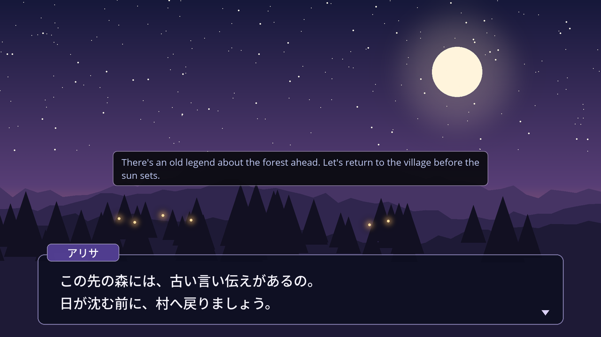
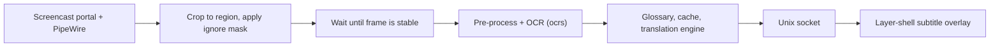

# cosmic-ext-translator

Translates on-screen text in games and visual novels on the COSMIC desktop. It reads a screen region you choose, runs OCR locally, and shows the translation as a subtitle line on top of the game. The subtitle overlay does not take mouse or keyboard input, so the game keeps focus.

<p align="center">
  
</p>

Japanese dialogue read with PaddleOCR, translated with Google Translate, and shown by the subtitle overlay. The scene is a test image made for this screenshot.

<p align="center">
  
  &nbsp;&nbsp;
  
</p>

## Contents

- [Requirements](#requirements)
- [Installation](#installation)
- [Usage](#usage)
- [Translation engines](#translation-engines)
- [Settings](#settings)
- [Limitations](#limitations)
- [Troubleshooting](#troubleshooting)
- [Development](#development)
- [How it works](#how-it-works)
- [License](#license)

## Requirements

- COSMIC desktop on Wayland, with `xdg-desktop-portal-cosmic` and PipeWire running.
- Rust toolchain (stable) and [`just`](https://github.com/casey/just).
- Build dependencies. On Pop!_OS or Ubuntu 24.04 and later:

  ```sh
  sudo apt install build-essential pkg-config clang libclang-dev \
      libpipewire-0.3-dev libspa-0.2-dev libwayland-dev libxkbcommon-dev \
      libdbus-1-dev just
  ```

- Network access on first start, to download the OCR models (about 12 MB for Latin text, another 21 MB for Japanese or Chinese; see [OCR models](#ocr-models)).

## Installation

### Method 1: Single-Line Quick Install

Downloads the latest release archive, verifies it against the release's `SHA256SUMS`, installs the binaries, desktop entry and icon to `~/.local`, and reloads the panel (no root required):

```bash
curl -fsSL https://raw.githubusercontent.com/Hasmolam/cosmic-ext-translator/master/install.sh | bash
```

To install a specific release, append `-s -- --version v0.2.0`. To read the script before running it, download it first and run `bash install.sh`.

To uninstall:
```bash
curl -fsSL https://raw.githubusercontent.com/Hasmolam/cosmic-ext-translator/master/uninstall.sh | bash
```

### Method 2: Pop!_OS / Ubuntu (.deb Package)

Download the `.deb` package and `SHA256SUMS` from the [latest release](https://github.com/Hasmolam/cosmic-ext-translator/releases/latest), verify and install it:

```bash
sha256sum -c --ignore-missing SHA256SUMS
sudo apt install ./cosmic-ext-translator_*_amd64.deb
```

Release assets are built by GitHub Actions. Their build provenance can be checked with `gh attestation verify <file> --repo Hasmolam/cosmic-ext-translator`.

Or double-click the `.deb` file in your file manager to install via the COSMIC App Center.

To uninstall:
```bash
sudo apt remove cosmic-ext-translator
```

### Method 3: Arch Linux (PKGBUILD)

```bash
git clone https://github.com/Hasmolam/cosmic-ext-translator.git
cd cosmic-ext-translator/packaging/arch
makepkg -si
```

### Method 4: Build from Source

```bash
git clone https://github.com/Hasmolam/cosmic-ext-translator.git
cd cosmic-ext-translator
just build-release

# Install for current user only to ~/.local (no root required).
# Builds first, then restarts the running panel applet; the panel itself keeps running.
just install-user

# Or system-wide installation (installs to /usr, requires sudo):
sudo $(which just) install
```

*(You can also build a `.deb` package locally by running `just deb`.)*

### Adding to the Panel

In COSMIC Desktop settings:
**Settings → Desktop → Panel → (Select Panel) → Configure panel applets → Add Applet → "Screen Translator"**

**Upgrading from 0.1.x:** the application ID changed to `io.github.hasmolam.CosmicExtTranslator`. Settings are migrated on first start, and `install.sh` / `just install-user` update the panel entry. After upgrading the `.deb` or Arch package, add the applet to the panel again.

To uninstall a source install:
```bash
just uninstall-user
# or for system-wide:
sudo $(which just) uninstall
```

## Usage

1. Start the game, preferably in borderless windowed or full-screen mode.
2. Open the applet in the panel and pick a region preset:
   - **Bottom 25%**: dialogue boxes in most RPGs.
   - **Bottom 33%**: larger visual novel text boxes.
   - **Full screen**
   - **Custom**: press `Super + Alt + S` and drag a rectangle over the text box.
3. Turn translation on. The first time, the portal asks which screen to share. The choice is remembered.
4. Translations appear at the bottom of the screen. New text is translated once it stops changing, so text that is typed out letter by letter is translated only after the line is complete.

### Shortcuts

Registered through the XDG Global Shortcuts portal. You can change them in COSMIC's keyboard settings.

| Shortcut | Action |
| :--- | :--- |
| `Super + Alt + S` | Select capture region |
| `Super + Alt + T` | Start/stop translation |
| `Super + Alt + H` | Show/hide subtitles |
| `Super + Alt + C` | Translate the current screen once |

## Translation engines

Select an engine in **Settings → Engine**.

| Engine | Needs | Notes |
| :--- | :--- | :--- |
| Google Translate | Nothing | Default. Uses the public web endpoint. It can be rate-limited during heavy use. |
| DeepL | API key | Free or Pro key from deepl.com. |
| Ollama | Local [Ollama](https://ollama.com/) server | Default `http://localhost:11434` with `qwen2.5:3b`. Runs fully offline. Recent dialogue lines are sent as context. |
| OpenAI-compatible | Endpoint, API key, model | Default `https://api.openai.com/v1` with `gpt-4o-mini`. Works with any server that implements the Chat Completions API. |

To use Ollama:

```sh
ollama pull qwen2.5:3b
```

If an engine returns HTTP 429, requests are retried with backoff and the subtitle overlay shows a countdown.

## Settings

The settings window has five tabs. Open it from the applet, or run `cosmic-applet-translator` without arguments.

| Tab | What it controls |
| :--- | :--- |
| Capture | Region, ignore region, settle time, binarization, background blur filter. Includes a live preview of what the OCR sees. |
| Engine | Translation engine, credentials, source and target language (defaults: auto → Turkish). The target list contains the 15 languages accepted by all engines; a code set by hand in the config file is kept. For Japanese, Chinese and Korean also the OCR engine and text direction. |
| Display | Subtitle position, vertical offset, font size, opacity, display duration. |
| Glossary | Fixed translations for character names and game terms. |
| History | The last 500 translations. Searchable, with copy to clipboard. |

<p align="center">
  
</p>

Settings are stored with `cosmic-config` under `~/.config/cosmic/io.github.hasmolam.CosmicExtTranslator/`.

Useful options for difficult games:

- **Ignore region**: excludes part of the capture region, such as an animated character portrait or a mini-map. Without it, movement there keeps restarting the settle timer.
- **Settle time**: how long the text must stay unchanged before OCR runs. Increase it if half-finished lines get translated.
- **Binarization / blur filter**: try these when text sits on a busy or gradient background.

### Japanese text

Select **Japanese** as the source language in the Engine tab. Japanese and Simplified Chinese are read with [PaddleOCR](https://github.com/PaddlePaddle/PaddleOCR) PP-OCRv5 models, which are downloaded on first use (about 21 MB). If the download fails, Tesseract is used when it is installed:

```sh
sudo apt install tesseract-ocr tesseract-ocr-jpn tesseract-ocr-jpn-vert   # Debian, Ubuntu, Pop!_OS
sudo pacman -S tesseract tesseract-data-jpn tesseract-data-jpn_vert         # Arch
```

The **OCR engine** setting (Japanese and Chinese only) selects *Automatic* (PaddleOCR, then Tesseract), *PaddleOCR* or *Tesseract*. Korean always uses Tesseract with `tesseract-ocr-kor`.

The **Text direction** setting appears for Japanese, Chinese, and Korean. PaddleOCR reads horizontal and vertical lines in the same pass. With Tesseract, *Automatic* reads horizontal text and retries with the vertical model (`jpn_vert`) when the result looks like vertical text. Set *Vertical* for visual novels that only use vertical text. Small ruby text (furigana) above or beside kanji is removed before translation.

### OCR models

On first start the [ocrs](https://github.com/robertknight/ocrs) detection and recognition models are downloaded to `$XDG_DATA_HOME/cosmic-ext-translator/models` (usually `~/.local/share/cosmic-ext-translator/models`). If the models are present in `/usr/share/cosmic-ext-translator/models`, that copy is used and nothing is downloaded. For offline machines, place `text-detection.onnx` and `text-recognition.onnx` (or the older `text-detection.rten` / `text-recognition.rten`) in either directory.

The PaddleOCR set lives in the `ppocrv5/` sub-directory of the same locations: `ppocrv5-mobile-det.onnx`, `ppocrv5-mobile-rec.onnx` and `ppocrv5-dict.txt`, from the [`models-v1` release](https://github.com/Hasmolam/cosmic-ext-translator/releases/tag/models-v1). Downloads are checked against the SHA-256 sums in [packaging/models/SHA256SUMS](packaging/models/SHA256SUMS).

Downloads are written to a temporary file and only moved into place after the model parses. A model file that fails to load is renamed to `*.corrupt` and downloaded again. If no model can be loaded, the applet popup and the HUD show the reason instead of starting the translation loop.

## Limitations

- **The bundled `ocrs` models recognize only Latin script.** Japanese and Simplified Chinese need the PaddleOCR download or Tesseract; Korean needs Tesseract. If no engine is available, the applet reports why. PaddleOCR accuracy on stylized and pixel fonts has not been measured yet; see [docs/JAPANESE_SUPPORT_PLAN.md](docs/JAPANESE_SUPPORT_PLAN.md).
- Only COSMIC is tested. Other wlroots-based compositors may work for the overlay, but the applet requires the COSMIC panel.
- Games that bypass the compositor (direct scanout through some full-screen modes) may produce black frames. Use borderless windowed mode in that case.
- Stylized or pixel fonts reduce OCR accuracy.

## Troubleshooting

| Problem | What to check |
| :--- | :--- |
| No subtitles appear | Make sure translation is on and the HUD is visible (`Super + Alt + H`). Check the preview in the Capture tab. |
| The screen share prompt appears every time | The portal rejected the saved token, for example after a monitor change. Select the screen again. |
| Lines are translated before they finish | Increase the settle time. Set an ignore region over animated parts. |
| Nothing is translated after a while | The engine may be rate-limited. Wait for the countdown or switch to Ollama. |
| Popup shows "Text recognition unavailable" | Read the reason below it. For Japanese/Chinese check network access for the PaddleOCR download or install Tesseract and its language data; for Korean install Tesseract; otherwise check network access for the model download. |
| Status shows "Screen capture could not be started" | The reason is shown below the status. If the screen share dialog worked before, restart the portal with `systemctl --user restart xdg-desktop-portal` and try again. |
| Build fails with `xkbcommon` or `libpipewire-0.3` not found | Install the `-dev` packages listed under [Requirements](#requirements). |

Logs are written to `~/.local/state/cosmic-ext-translator/` (`$XDG_STATE_HOME` if set), one file per process: `applet.log` (panel), `settings.log` (settings window), `hud.log` and `selector.log` (overlay). A file larger than 5 MB is moved to `<name>.log.1` on the next start.

The default level does not record recognised text. For more detail, start the settings window from a terminal:

```sh
RUST_LOG=debug cosmic-applet-translator
```

At `debug` level the log files contain the recognised and translated text.

## Development

```sh
just check        # cargo check --workspace --all-targets
just lint         # cargo clippy --workspace --all-targets -- -D warnings
just test         # cargo test --workspace
just test-e2e     # end-to-end tests
```

Tests use `MockOcrBackend` and do not need network access or OCR models.

Run the components directly:

```sh
cargo run -p cosmic-applet-translator                  # settings window
cargo run -p cosmic-applet-translator -- --applet      # applet mode
cargo run -p cosmic-translator-overlay -- --selector   # region picker
cargo run -p cosmic-translator-overlay -- --hud        # subtitle overlay
just test-capture                                      # capture test (needs Wayland + PipeWire)
```

Debug builds compile `ocrs`, `rten`, and `rten-vecmath` with `opt-level = 3`. Without this, OCR is too slow to use. Keep that section in `Cargo.toml`.

### Releasing

The version lives in `[workspace.package]` of `Cargo.toml`; `just version` prints it and the `.deb`, tarball and AppStream metadata use the same value.

1. Bump `version` in `Cargo.toml`, add a `<release>` entry to `crates/cosmic-applet-translator/resources/app.metainfo.xml`, and move the `[Unreleased]` notes in `CHANGELOG.md` to a new version section.
2. Commit, then tag and push: `git tag v0.2.0 && git push origin master v0.2.0`.
3. The `Release` workflow checks that the tag matches `Cargo.toml`, runs the tests, builds the tarball and `.deb` with `just dist`, attests them, and publishes the release with the `CHANGELOG.md` section as notes.

`just dist` builds the same assets locally in `dist/`.

### Workspace layout

| Crate | Contents |
| :--- | :--- |
| `crates/translator-protocol` | Types shared by all processes: HUD messages and socket, selector output, regions, language codes, log setup. |
| `crates/translator-capture` | Screen-sharing portal, PipeWire capture thread, region crop and masking. |
| `crates/translator-ocr` | OCR engines (ocrs, PaddleOCR, Tesseract), model download, CJK layout, furigana filter. |
| `crates/translator-translate` | Translation engines, dialogue context, speaker tags, fuzzy cache, rate limiting. |
| `crates/translator-core` | Library without GUI: debouncing, pre-processing, the main loop and global shortcuts. Re-exports the crates above. |
| `crates/cosmic-translator-overlay` | Depends only on `translator-protocol`. `--hud`: subtitle overlay. `--selector`: region picker, prints `ROI_SELECTED:{"x":..,"y":..,"width":..,"height":..}` to stdout. |
| `crates/cosmic-applet-translator` | Panel applet and settings window. |

UI strings are translated with Fluent (`i18n/en`, `i18n/tr` in each GUI crate).

## How it works



- The PipeWire loop runs on its own OS thread. Each frame is cropped to the region and the buffer is released right away.
- Frames are compared with a 64-bit dHash. OCR runs only after the frame has stayed unchanged for the settle time. The recognized text is then compared with the previous line to skip duplicates.
- Speaker names in formats like `【Name】` or `Name:` are separated from the dialogue before translation.
- Translations are cached in a fuzzy LRU cache, so small OCR differences in a repeated line do not trigger a new request.
- The applet sends results to the overlay over `$XDG_RUNTIME_DIR/cosmic-ext-translator-hud.sock`, and starts the overlay process if it is not running.
- The overlay is a `wlr-layer-shell` surface with an empty input region, so all input goes to the game.

## License

[GPL-3.0-or-later](LICENSE)

The PaddleOCR model files downloaded at runtime are licensed under Apache-2.0 by the PaddlePaddle Authors; see [packaging/models/NOTICE.md](packaging/models/NOTICE.md).
